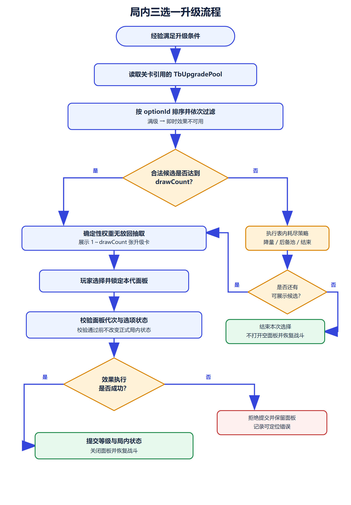

# 技能类型与局内升级系统策划案 V1.1

本案用于统一技能能力拆分、局内三选一和 Luban 配置边界。首个实施批只调整现有升级池与升级选项，不为尚未出现的组合效果、等级里程碑、前置和互斥关系预建空表。

# 设计目的

1. 将三选一权重归属升级池，使同一选项未来进入不同池时可以使用不同权重。
2. 为合法候选不足三项的情况提供配置化处理，避免当前运行时直接抛出异常并中断单局。
3. 保留当前技能解锁、属性强化和即时恢复三种成熟结构，不因未来扩展提前增加薄表和空字段。
4. 配置数据只由 Excel 经 Luban 生成；运行时不复制概率、数量、文本、资源或效果数值。
5. 技能投递、组合效果、状态和召唤仍按独立阶段设计，只有出现真实数据需求后才建立对应表。

# 名词解释

| 名词 | 定义 |
|---|---|
| 升级池 | 某关卡或模式允许参与抽取的升级选项集合，持有展示数量、耗尽策略和选项权重。 |
| 升级选项 | 玩家在升级面板中选择的成长项，当前支持技能解锁、属性强化和即时恢复。 |
| 池条目 | 升级池内的 optionId + weight 组合；权重属于池与选项的关系。 |
| 合法候选 | 未满级、当前效果可用且位于本池中的升级选项。 |
| 无放回抽取 | 同一面板已经抽中的选项从候选集中移除，不会重复出现。 |
| 耗尽策略 | 合法候选少于 drawCount 时，由配置决定降量展示、切换后备池或结束本次选择。 |
| 确定性随机 | 相同随机种子、选择代次和候选数据产生相同抽取结果。 |
| 扩展关系 | 前置、互斥、多效果和等级里程碑等尚无正式数据的后续能力，不进入本期源表。 |

# 流程介绍

## 局内三选一流程图

## 流程说明

1. 角色经验达到升级条件后暂停战斗推进，读取关卡明确引用的 TbUpgradePool。
2. 按 optionId 升序建立候选，过滤已达到 maxRank 的选项和当前不可执行的即时效果。
3. 候选不少于 drawCount 时，使用本局确定性随机源按池条目权重无放回抽取。
4. 候选少于 drawCount 时，只执行表内 exhaustionPolicy。本期正式池使用 ReduceOfferCount：剩余几项就展示几项，零项时结束本次选择。
5. 玩家选择后锁定本代面板，校验请求仍然有效，再执行该选项唯一类型对应的效果。
6. 效果成功后提交升级等级和局内状态，关闭面板并恢复战斗；效果失败则不增加等级，并保留明确错误。
7. 即时恢复只在选择当次执行，读档或升级账本重建时不得重复结算。

# 功能设定

## 系统范围

| 范围 | 本案处理 | 本案不处理 |
|---|---|---|
| 三选一 | 权重归池、确定性抽取、满级过滤、效果可用性、耗尽策略 | 刷新、锁定、重掷、付费选项 |
| 升级效果 | 现有技能解锁、属性强化、即时恢复 | 多效果组合、Buff、位移、护盾、召唤 |
| 技能架构 | 保留组合式长期方向 | 本批新增投递器、弹体或状态表 |
| UI | 1～3 张卡片的数据与交互契约 | 本批重做 Prefab 和美术资源 |
| 存档 | 保留现有升级等级语义 | 本批定义跨版本存档迁移 |

## 当前基础与参考结论

当前正式链路为：TbSkill → TbSkillCombat → CombatRunDefinition → CombatRunModel → 升级面板。升级池 1 包含 9 个选项：4 个技能解锁、4 个属性强化、1 个即时恢复；每次按权重无放回展示 3 项。

旧项目《技能类型参数.xlsx》和 docs/参考_dataTable 只用于能力覆盖与关系设计，不迁入旧 ID、旧资源名和匿名参数。参考结构中可以直接落地的是“池持有带权条目”；前置图、互斥组、等级效果和效果分组只有在当前项目出现真实数据时再引入。

| 参考结构 | 本期处理 | 后续触发条件 |
|---|---|---|
| 池与带权条目 | 立即采用，权重从选项迁入池条目 | 无 |
| 前置有向图 | 只保留设计原则，不建字段 | 出现首组真实技能前置链 |
| 互斥分组 | 只保留设计原则，不建表 | 出现首组真实分支互斥 |
| 等级里程碑 | 不建空结构 | 同一选项不同等级需要不同效果 |
| 多效果组合 | 不拆效果表 | 一个选项需要同时执行两种以上效果，或效果需要跨选项复用 |
| 技能、Buff、子弹分表 | 作为技能系统长期方向 | 对应玩法进入正式开发阶段 |

规范要求定向审查的 Tower 参考工程 Assets 目录当前不可访问。本版记录该事实，并以当前项目的单机范围、Luban 唯一数据源、Entities 1.0、YooAsset 2.3.19 和既有测试体系为准；正式技能架构扩展前再次检查参考目录。

## 技能组合方向

完整技能长期按五段组合：

技能身份 → 施法与目标 → 投递器与发射图案 → 命中效果 → 触发与修饰

例如“环形火球命中后爆炸并附加灼烧”应由 Projectile 投递、Radial 图案、弹体定义、爆炸效果和灼烧状态组合，而不是新增一个“环形爆炸灼烧技能类型”。该方向用于后续技能模块，不要求本期三选一提前建立对应空表。

| 模块 | 负责 | 不负责 |
|---|---|---|
| 技能定义 | 身份、战斗配置和表现集合引用 | 运行时冷却与命中状态 |
| 施法与目标 | 间隔、前后摇、阵营、范围、数量和排序 | 弹体运动和伤害结算 |
| 投递与图案 | Melee、Projectile、TargetArea、Beam、Summon 的生成形态 | 直接修改生命和属性 |
| 效果与状态 | 伤害、治疗、属性、控制、护盾、子技能及状态生命周期 | 加载表现资源 |
| 表现事件 | 飞行、命中、区域、状态和召唤的表现载荷 | 参与确定性数值结算 |

## 三选一候选规则

候选资格固定按以下顺序计算，UI 不参与资格判断：

1. 从 TbUpgradePool.entries 取得选项引用和池内权重。
2. 排除 currentRank >= maxRank 的选项。
3. 排除当前不可执行的即时效果；首批仅“满生命时不出现立即恢复”。
4. 按 optionId 稳定排序后再进行权重抽取，避免容器遍历顺序改变结果。
5. 同一面板使用无放回抽取，不出现重复选项。

前置和互斥不进入本期运行逻辑。后续确有数据时，先补方案与表结构，再接入筛选顺序；不得在代码中临时判断指定选项 ID。

## 权重与耗尽规则

权重属于 UpgradePoolEntry。同一选项未来进入多个池时，可以在不同关卡、角色或模式中配置不同权重。权重必须为正整数；禁用选项通过移出池处理，不使用零权重表达开关。

| 耗尽策略 | 行为 |
|---|---|
| ReduceOfferCount | 展示全部剩余合法候选；剩余为零时结束本次选择。 |
| FallbackPool | 切换到 fallbackPoolId 后重新执行完整筛选；回退链不得成环。 |
| EndUpgradeSelection | 不展示空面板，结束本次选择并记录原因。 |

耗尽策略直接以“候选是否少于 drawCount”为判断条件，不再配置 minimumOfferCount。本期池 1 使用 ReduceOfferCount，明确修复当前代码在合法候选少于 3 项时抛出异常的问题。

## 升级效果规则

当前 9 个选项全部是“一项对应一种效果”，继续由 EUpgradeOptionType 分派，避免为只有两个有效字段的载荷建立独立业务表。

| 类型 | 使用字段 | 约束 | 生命周期 |
|---|---|---|---|
| SkillUnlock | targetSkillId | 必须引用 TbSkill；modifiers、healMilli 为空 | 局内持久，可由升级状态重建 |
| Attribute | modifiers | 至少一项 RunAttributeModifier；targetSkillId、healMilli 为空 | 局内持久，可由升级状态重建 |
| Heal | healMilli | 必须为正整数；targetSkillId、modifiers 为空 | 选择当次即时执行，不随账本重复触发 |

只有出现“单选项多效果、等级效果不同、效果跨选项复用”之一时，才新增统一的效果组结构；不会按每种效果拆成独立两列表。

## 异常处理

| 异常 | 处理 |
|---|---|
| 池为空或条目重复 | 配置生成或启动校验失败，不进入战斗。 |
| 权重非正数 | 配置校验失败。 |
| 后备池缺失或回退成环 | 配置校验失败。 |
| 选项类型与字段组合不一致 | 配置校验失败，并输出选项 ID。 |
| 玩家提交过期面板 | 拒绝提交，不改变任何局内状态。 |
| 效果执行失败 | 不增加升级等级，保留面板并记录错误。 |

# 界面设定

本期不改造现有升级 Prefab，只定义数据与交互契约。

| 元素 | 显示规则 | 交互规则 |
|---|---|---|
| 升级卡 | 显示名称、说明、图标、当前等级和升级后等级 | 仅合法候选生成卡片 |
| 卡片数量 | 正常为 drawCount；ReduceOfferCount 时允许 1～2 张 | 不生成空白占位卡 |
| 选择反馈 | 点击后锁定本代面板，等待结果提交 | 重复点击和旧 generation 请求无效 |
| 零候选 | 不打开空面板，记录耗尽原因后恢复流程 | 不允许软锁战斗 |
| 错误状态 | 保留面板并输出可定位错误 | 不静默吞掉、不增加等级 |

# 美术需求

三选一配置迁移阶段不新增美术资产，不生成独立预览纹理、材质、网格或 Prefab。当前 iconResourceId 原样保留为空，待正式 UI 资源进入 TbResource 后再填写。后续 UI 调整只绑定现有正式资源和用户维护的 Prefab，不创建平行 Runtime 节点。

# 配置表结构

## 枚举与 Bean

| 配置 | 内容 | 用途 |
|---|---|---|
| EUpgradeOptionType | SkillUnlock=1；Attribute=2；Heal=3 | 复用现有三种升级效果分派 |
| EUpgradeExhaustionPolicy | ReduceOfferCount=1；FallbackPool=2；EndUpgradeSelection=3 | 候选少于 drawCount 时的处理规则 |
| UpgradePoolEntry | optionId；weight | 选项强引用与池内正整数权重 |
| RunAttributeModifier | attributeId；operation；valueMilli | 复用现有属性修改结构 |

不新增 EUpgradeEffectKind、UpgradeEffectRef、UpgradeRequirement 或 UpgradeMilestoneEffect。

## 业务表

| 表 | 字段 | 约束 |
|---|---|---|
| TbUpgradePool | id；drawCount；exhaustionPolicy；fallbackPoolId；entries | drawCount 正整数；同池 optionId 唯一；FallbackPool 时必须填写后备池 |
| TbUpgradeOption | id；name；description；type；targetSkillId；maxRank；modifiers；healMilli；iconResourceId | maxRank 正整数；类型与三个载荷字段严格互斥 |

业务表保持两张。前置、互斥、里程碑和效果组只记录为后续扩展条件，不以空表、空列或未使用枚举进入本期 Luban。

## 当前数据迁移

| 选项范围 | 类型与载荷 | 最大等级 | 池 1 权重 |
|---|---|---|---|
| 40001～40004 | SkillUnlock；技能引用保持 20014、20032、20028、20043 | 1 | 各 100 |
| 40005～40008 | Attribute；原 RunAttributeModifier 数值不变 | 99 | 各 100 |
| 40009 | Heal；healMilli=20000 | 99 | 80 |

池 1 配置为：drawCount=3、exhaustionPolicy=ReduceOfferCount、fallbackPoolId 为空。选项名称、说明、最大等级、技能引用、属性修改、治疗量和权重均不改变，只调整权重的归属位置。

## 静态校验

| 校验组 | 必须检查 |
|---|---|
| 引用 | 池条目、技能、属性和资源引用全部可解析 |
| 池结构 | drawCount 为正；条目不重复；权重为正；后备池规则正确且无环 |
| 选项结构 | type 有效；maxRank 为正；类型专用字段必须且只能填写对应组合 |
| 数据等价 | 9 个选项的 ID、名称、说明、等级、技能、属性、治疗量和权重与迁移前一致 |
| 数据源 | Excel 可由 PowerShell 7 调用 Luban 复现；正式生成 C# 与 bytes 同步交付 |

# 实施阶段

| 阶段 | 内容 | 进入条件 | 完成条件 |
|---|---|---|---|
| U 表结构迁移 | 权重迁入池条目、增加耗尽策略、保留两张业务表 | 本案定稿 | Luban 临时导出与表级校验通过 |
| U 代码接入 | 运行时消费池条目与耗尽策略 | U 表结构通过 | .NET 编译和确定性测试通过，正式生成物同步 |
| A 基础抽象 | 为 Projectile、Melee、TargetArea 建立统一施法请求 | U 代码接入通过 | 现有战斗行为无漂移 |
| B 投递扩展 | Stream、Fan、Radial、Matrix、CrossRotating、Chain、Beam | A 通过 | 每类有正式表数据、纯逻辑测试和可视回归 |
| C 效果与状态 | 按真实技能需求建立组合效果、状态和触发结构 | B 通过 | 效果事务、状态生命周期和触发门禁闭环 |
| D 召唤与场景物 | 新增 Summon、PersistentArea、SceneSpawner | C 通过 | 容量、对象池、清场和资源生命周期验证通过 |

## 2026-09-12 执行状态

- U 表结构迁移：完成。业务表保持两张，权重迁入 UpgradePoolEntry，并增加候选耗尽策略。
- U 代码接入：完成。正式 Luban C# 与 bytes 已同步；运行时支持降量、后备池和结束选择，入口池与后备池技能一并纳入预加载闭包。
- 自动化验证：PowerShell 7 配置闸门、Unity 编译、EditMode、PlayMode 和正式场景升级卡片回调均通过。
- 人工验收：待用户在 Unity 中以真实输入完成至少一次升级选择并明确反馈“测试通过”或“验收通过”。
- 下一阶段：A 基础抽象；进入前重新检查 Tower 参考路径是否可访问，并先确认施法请求边界。

# 验收标准

## 表结构阶段

- 业务工作簿只有 TbUpgradePool 与 TbUpgradeOption 两张。
- 权重只存在于 UpgradePoolEntry，选项表不再保存权重。
- 不存在空的前置、互斥、里程碑和效果载荷业务表。
- 当前 9 个升级选项的名称、说明、最大等级、技能引用、属性修改、治疗量和权重不变。
- Luban 在临时目录完成 C# 与 bytes 生成；不存在悬空引用、重复 ID、非法类型组合或 Schema 错误。
- 正式运行时代码尚未切换前，不覆盖项目当前生成目录，避免制造半迁移的编译状态。

## 代码与自动化阶段

- 固定随机种子和相同输入下，候选顺序与选择结果可重复。
- 权重无放回抽取、满级过滤、治疗可用性和三种耗尽策略均有纯逻辑测试。
- 当前 4 个技能解锁、4 个属性强化和 1 个治疗的既有行为保持一致；候选不足异常按新耗尽策略修正。
- 代码中不存在与 Excel 重复的业务默认值。

## Unity 与人工阶段

Unity 空闲后再执行正式战斗场景回归：验证升级暂停、1～3 张卡片显示、点击提交、战斗恢复、重开、结算和退出清理。最终由用户以真实输入完成至少一局；只有明确反馈“测试通过”或“验收通过”才记录人工验收通过。
